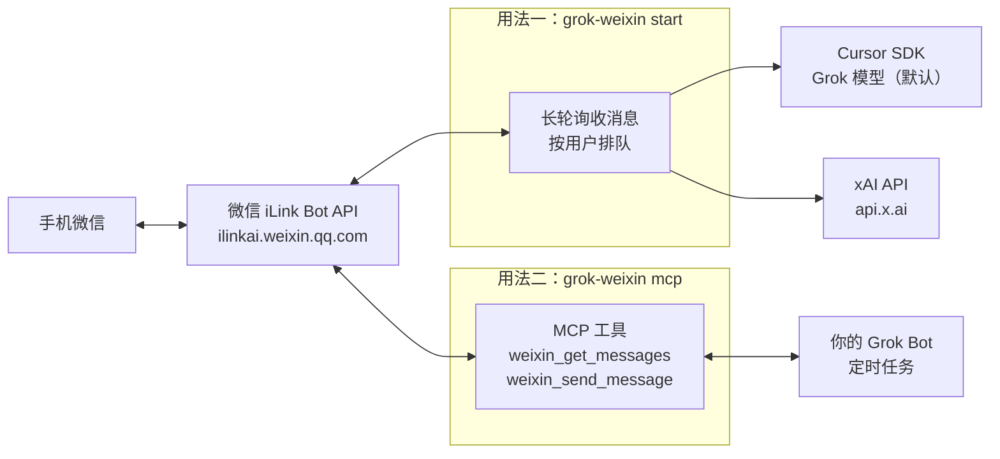
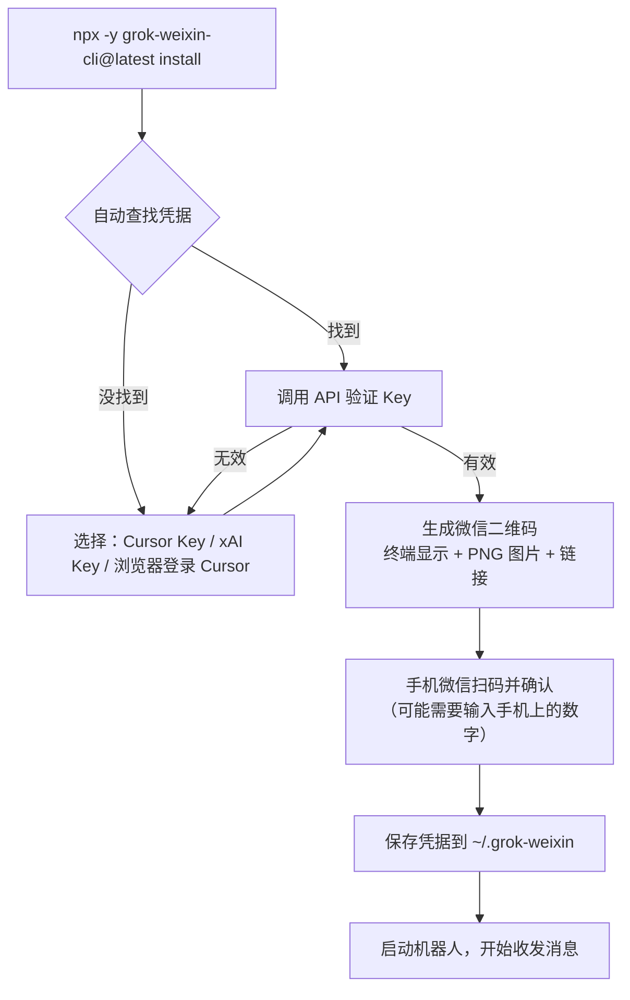
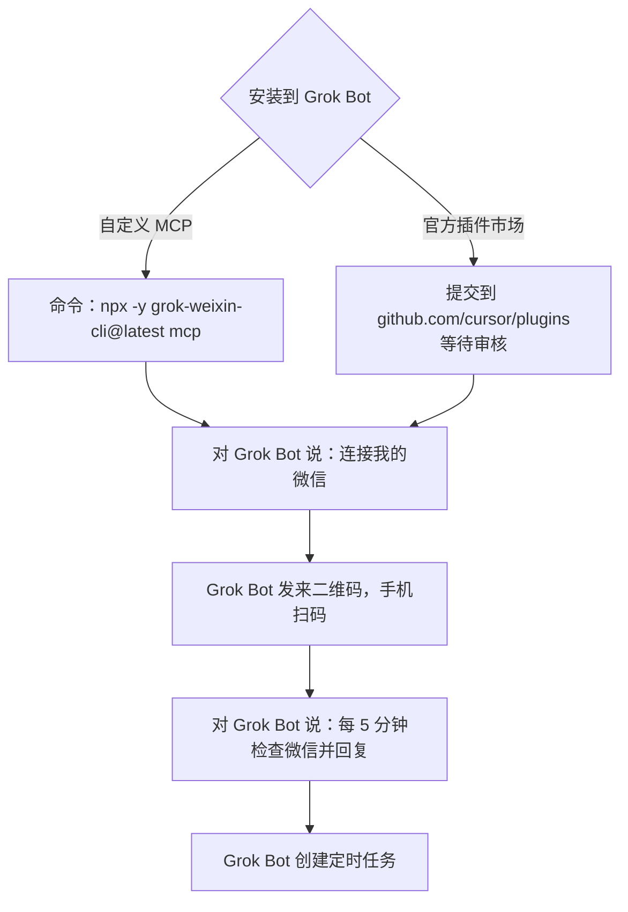

# grok-weixin-cli

把微信（WeChat）连接到 Grok。提供三种用法：

- **实时机器人**：在你的电脑或服务器上运行 `grok-weixin start`，微信里发消息，几秒内收到 Grok 的回复。默认后端是独立的 Cursor agent，或 xAI API。
- **Grok Bot 插件（MCP）**：把微信变成工具，让 Grok Bot 直接读微信、回微信。这会消费微信游标，不是下面的桥接。
- **可选的 Grok Bot 桥接**：`provider=grok-bot`。微信仍由本进程收发，官方 Routine webhook 只负责叫醒你当前的 Bot，自定义 MCP 再领取队列并提交回复。它不是官方微信渠道，默认也不自动发送。说明见 [docs/grok-bot-bridge.zh.md](docs/grok-bot-bridge.zh.md)。仓库里的代码不会切换机器上已经在跑的 `grok-weixin-cli@0.1.0`。

不需要安装 OpenClaw。微信协议部分（iLink Bot API：扫码登录、长轮询收消息、发消息、"正在输入"状态、图片解密）移植自腾讯的 [`@tencent-weixin/openclaw-weixin`](https://www.npmjs.com/package/@tencent-weixin/openclaw-weixin)（MIT）。官方的 `@tencent-weixin/openclaw-weixin-cli` 只是一个调用 `openclaw plugins install` 的安装器。

## 目录

- [工作原理](#工作原理)
- [选择用法](#选择用法)
- [用法一：实时机器人](#用法一实时机器人)
- [用法二：Grok Bot 插件](#用法二grok-bot-插件)
- [用法三：当前 Grok Bot 的桥接](#用法三当前-grok-bot-的桥接)
- [命令](#命令)
- [配置](#配置)
- [安全](#安全)
- [故障排查](#故障排查)
- [开发](#开发)

## 工作原理



扫码登录后，微信服务器给这个工具发放一个机器人凭据（bot token）。之后：

1. 工具调用 `getupdates` 长轮询接收新消息，每条消息都带一个 `context_token`。
2. 文字、语音转写文字、图片（下载后 AES 解密）和引用内容被整理后交给 Grok。
3. 回复去掉微信不支持的 Markdown，超过 2000 字拆成多条，带着 `context_token` 通过 `sendmessage` 发回。

## 选择用法

| | 实时机器人 | Grok Bot 插件 |
|---|---|---|
| 回复速度 | 几秒 | 取决于定时任务间隔，例如每 5 分钟 |
| 谁来回复 | 一个只开了网页搜索的 Cursor agent，或 xAI API | 你自己的 Grok Bot，能用它连接的应用、记忆和技能 |
| 运行在哪 | 你的电脑或服务器，需要一直开着 | Grok Bot 的云电脑 |
| 主动推送 | 不支持 | 支持，例如每天早上把简报发到微信 |
| 计费 | Cursor 账号额度，或 xAI API 按量 | Grok Bot 所在账号的额度 |

实时机器人和旧版 MCP 插件不能同时接收同一个状态目录。`grok-bot` 桥接同样独占这个目录的长轮询；它运行时，旧的 `weixin_get_messages` 和 `weixin_send_message` 会拒绝工作，避免新旧各回一封。详见[安全](#安全)。

## 用法一：实时机器人

### 前置条件

- Node.js 22.13 或更高版本
- 以下任意一种 Grok 凭据：
  - Cursor 账号（默认）：浏览器登录，或在 [Cursor Dashboard → Integrations](https://cursor.com/dashboard/integrations) 创建的 API Key
  - xAI API Key：在 [console.x.ai](https://console.x.ai) 创建

### 一键安装

```bash
npx -y grok-weixin-cli@latest install
```

（也可以 `git clone` 本仓库后运行 `npm install && node cli.mjs install`。）



凭据按这个顺序自动查找，找到第一个就用：

1. 环境变量 `CURSOR_API_KEY`、`CURSOR_API_KEY_FILE`（文件路径）、`CURSOR_SERVICE_ACCOUNT_KEY`
2. 环境变量 `XAI_API_KEY`
3. `~/.grok-weixin/config.json` 里保存过的 Key
4. `grok-weixin cursor-login` 保存的 Cursor 登录

也可以直接传入：`install --cursor-key <key>` 或 `install --xai-key <key>`。通过参数或终端输入的 Key 验证通过后才会保存（权限 600）；来自环境变量的 Key 不会写入文件。

以后再启动只需要 `grok-weixin start`（前台）或 `grok-weixin install --daemon`（后台，已绑定会跳过扫码）。

### 在 Grok Bot 或脚本里安装（无交互）

没有终端可以提问时（或加了 `--non-interactive`），`install` 不会等待输入，而是用退出码和固定格式的输出行告诉调用方下一步：

```bash
CURSOR_API_KEY=... npx -y grok-weixin-cli@latest install --non-interactive
```

| 输出 / 退出码 | 含义 | 下一步 |
|---|---|---|
| `CREDENTIALS=missing`，退出码 1 | 没找到凭据 | 设置 `CURSOR_API_KEY` 或 `XAI_API_KEY` 后重新运行 |
| `CREDENTIALS=invalid`，退出码 1 | Key 无效 | 换一个 Key |
| `QR_PNG=<路径>`、`QR_URL=<链接>` | 二维码已生成 | 把图片或链接发给用户扫码 |
| `STATUS=need_verify_code`，退出码 2 | 手机上显示了数字验证码 | 加上 `--verify-code <数字>` 重新运行 |
| `STATUS=timeout`，退出码 2 | 等待超时（默认 480 秒，`--wait` 修改） | 重新运行同一条命令，5 分钟内二维码不变 |
| `WEIXIN=connected`、`BOT_PID=<pid>` | 绑定完成，机器人已在后台运行 | 日志在 `~/.grok-weixin/bot.log`，`grok-weixin stop` 停止 |

在 Grok Bot 里，Key 建议通过它的密钥请求（secret request）提供，它会以环境变量的形式出现在云电脑上，不要直接贴在聊天里。Grok Bot 是否自动给云电脑注入 Cursor Key 取决于你的账号设置，`install` 会先自动查找，找不到才需要提供。

### 分步验证

```bash
grok-weixin status           # 微信是否已连接、用哪个后端、哪个模型
grok-weixin models           # Cursor 账号可用的 Grok 模型
grok-weixin ask "你好"        # 不经过微信，直接测试 Grok 能否回复
grok-weixin start            # 启动后在手机微信里给机器人发消息
```

启动后终端会打印每条收发记录：

```
02:10:01 已连接微信 bot=xxx  后端=Cursor grok-4.7
02:10:15 ← o9cq8xxx 今天北京天气怎么样
02:10:21 → o9cq8xxx 北京今天晴，最高 8°C……
```

在微信里可以测试这些：

| 发送 | 预期 |
|---|---|
| "我叫小明"，再问"我叫什么" | 回答"小明"，说明上下文有效 |
| `/reset`，再问"我叫什么" | 不再记得 |
| `/model` | 当前后端和模型 |
| `/help` | 命令列表 |
| 一张图片 | 描述图片内容 |
| 一条语音 | 按微信的语音转文字结果回答 |

### 后端

| `provider` | 说明 |
|---|---|
| `cursor`（默认） | 通过 [`@cursor/sdk`](https://cursor.com/docs/sdk/typescript) 用 Cursor 账号额度调用 Grok。每个微信用户对应一个本地 Cursor agent，工具只开放网页搜索和网页抓取，工作目录是一个空文件夹，所以碰不到你电脑上的终端和文件。可以联网查实时信息 |
| `xai` | 直接调用 `https://api.x.ai/v1/chat/completions`，对话历史保存在本地。不能联网搜索 |

切换：`grok-weixin config provider xai`

### 长期运行

机器人需要一直运行。关掉终端或电脑睡眠后就收不到回复了。最简单的是 `grok-weixin install --daemon`，它在后台运行，但机器重启后不会自动恢复。需要开机自启时可以用 pm2：

```bash
npm install -g pm2
pm2 start "grok-weixin start" --name grok-weixin
pm2 save
```

扫码登录需要交互，请先在服务器上运行一次 `grok-weixin install --no-start`。

## 用法二：Grok Bot 插件

`grok-weixin mcp` 以 stdio MCP 服务器运行，提供这些工具：

| 工具 | 作用 |
|---|---|
| `weixin_status` | 连接状态、账号主人 userId、可发送的联系人 |
| `weixin_login_start` | 生成登录二维码，返回图片和链接 |
| `weixin_login_check` | 检查扫码进度（每次最多等约 25 秒），支持数字验证码 |
| `weixin_get_messages` | 读取新消息，每条只返回一次，图片作为图片内容返回 |
| `weixin_send_message` | 发送文字，默认发给账号主人 |
| `weixin_logout` | 删除本地凭据 |

仓库根目录就是一个 Cursor 插件，格式和官方 X 插件相同：

```text
.cursor-plugin/plugin.json   插件描述
mcp.json                     MCP 服务器：npx -y grok-weixin-cli@latest mcp
skills/weixin/SKILL.md       告诉 Grok Bot 怎么登录、读消息、回复、推送
assets/logo.svg
```

### 安装流程



1. **装进 Grok Bot**，二选一：
   - 在 Grok Bot 里添加自定义 MCP 服务器，命令 `npx`，参数 `-y grok-weixin-cli@latest mcp`。
   - 把插件提交到 [cursor/plugins](https://github.com/cursor/plugins)，审核通过后可以从市场安装。

2. **连接微信**：对 Grok Bot 说"连接我的微信"。它会调用 `weixin_login_start` 把二维码发给你，你用手机扫码确认，它再调用 `weixin_login_check` 完成登录，并发一条测试消息给你。

3. **设置自动回复**：对 Grok Bot 说"每 5 分钟检查一次微信，有新消息就回复"。它会创建一个定时任务。

4. **主动推送**：例如"每天早上 8 点把我的日程和未读邮件总结发到我微信"。

### 不用 Grok Bot，在其他 MCP 客户端里使用

任何支持 stdio MCP 的客户端都可以用，例如 Cursor 的 `~/.cursor/mcp.json`：

```json
{
  "mcpServers": {
    "weixin": {
      "command": "npx",
      "args": ["-y", "grok-weixin-cli@latest", "mcp"]
    }
  }
}
```

也可以用本地路径：`"command": "node", "args": ["/path/to/grok-weixin-cli/cli.mjs", "mcp"]`。

## 用法三：当前 Grok Bot 的桥接

默认仍是 `cursor`。把 `provider` 设为 `grok-bot` 之后，`start` 不再调用 Cursor 或 xAI。它把通过白名单的消息写入本机队列，向你在环境变量里配置的 Routine webhook 发一次叫醒，再由 `bridge-mcp` 把回复交回微信。

HTTP 200 只表示 Bot 的一次 run 已开始。MCP 进程本身不会叫醒 Bot，也不会让微信历史逐条出现在当前聊天里。webhook 地址、字段名和工具名都不是官方 SDK。完整的已核实边界、占位配置、自定义契约、切换和回滚见 [docs/grok-bot-bridge.zh.md](docs/grok-bot-bridge.zh.md)。

占位启动（不要写入真实密钥）：

```bash
export GROK_WEIXIN_STATE_DIR=/path/to/isolated-grok-weixin-bridge
export GROK_WEIXIN_PROVIDER=grok-bot
export GROK_WEIXIN_ROUTINE_WEBHOOK_URL=https://example.invalid/replace-with-routine-post-url
export GROK_WEIXIN_ROUTINE_WEBHOOK_TOKEN=replace-with-routine-sender-key

node cli.mjs bridge-init --bot-binding weixin-assistant
node cli.mjs bridge-status
# 自动发送仍关闭。确认缺失 group_id 不能证明是单聊之后，才对本目录授权：
# node cli.mjs bridge-authorize --scope owner --accept-unverified-direct
node cli.mjs start
```

MCP 用另一个进程，并且必须是同一状态目录：

```bash
node cli.mjs bridge-mcp
```

带有 `group_id` 的消息会拒绝。没有 `group_id` 只能记为未验证，不能当成已证明的单聊。`allowFrom=*` 会拒绝启动。

## 命令

| 命令 | 说明 |
|---|---|
| `install` | 查找或输入凭据 → 验证 → 扫码连接微信 → 启动机器人 |
| `login` | 扫码连接或重新连接微信 |
| `start` | 在前台启动实时机器人 |
| `stop` | 停止后台运行的机器人 |
| `mcp` | 以旧版 MCP 服务器运行，直接读微信 |
| `bridge-init` | 初始化 Grok Bot 桥接。不自动发送，不打印令牌 |
| `bridge-authorize` | 只给当前状态目录授权主人自动发送或确认发送 |
| `bridge-revoke` | 撤销该授权 |
| `bridge-resolve` | 关闭不确定的发送，或在你确认微信未发出后允许再提交一次 |
| `bridge-status` | 查看桥接状态，不打印密钥 |
| `bridge-mcp` | 以桥接 MCP 运行，只访问队列 |
| `cursor-login` | 在浏览器中登录 Cursor |
| `models` | 列出 Cursor 账号可用的 Grok 模型 |
| `ask <text>` | 在终端问 Grok 一句话，测试后端 |
| `status` | 查看连接与配置状态 |
| `config [key] [value]` | 查看或修改配置 |
| `logout` | 删除本地微信凭据与聊天记录 |

`install` 和 `login` 的选项：

| 选项 | 说明 |
|---|---|
| `--cursor-key <key>` / `--xai-key <key>` | 直接传入 Key（仅 `install`） |
| `--non-interactive` | 不在终端提问；没有终端时自动开启 |
| `--verify-code <数字>` | 手机微信显示的数字验证码 |
| `--wait <秒>` | 最多等待扫码多久，默认 480 |
| `--daemon` | 绑定后在后台启动机器人（`--non-interactive` 时默认开启，仅 `install`） |
| `--no-start` | 只完成绑定，不启动机器人（仅 `install`） |

退出码：0 完成，1 出错，2 等待用户扫码或输入验证码（重新运行同一条命令即可继续）。

微信内命令（实时机器人）：`/reset` 清空上下文，`/model` 查看模型，`/help` 帮助。

## 配置

保存在 `~/.grok-weixin/config.json`，用 `grok-weixin config <key> <value>` 修改：

| 配置项 | 默认值 | 环境变量 | 说明 |
|---|---|---|---|
| `provider` | `cursor` | `GROK_WEIXIN_PROVIDER` | `cursor`、`xai` 或 `grok-bot`。`grok-bot` 不调用模型 |
| `cursorModel` | `grok-4.7` | | `provider=cursor` 时的模型，用 `models` 查看可选值 |
| `cursorApiKey` | | `CURSOR_API_KEY`、`CURSOR_API_KEY_FILE`、`CURSOR_SERVICE_ACCOUNT_KEY` | 不填则使用 `cursor-login` 的登录凭据（`~/.cursor/sdk/auth.json`，90 天有效） |
| `apiKey` | | `XAI_API_KEY` | xAI API Key |
| `model` | `grok-4` | `GROK_MODEL` | `provider=xai` 时的模型 |
| `apiBaseUrl` | `https://api.x.ai/v1` | `XAI_BASE_URL` | `provider=xai` 时的接口地址 |
| `systemPrompt` | 中文助手提示词 | | 系统提示词 |
| `historyTurns` | `20` | | `provider=xai` 时每个用户保留的对话轮数 |
| `allowFrom` | `[]` | | 允许对话的微信 userId，逗号分隔。为空时只允许扫码的账号主人，`*` 表示所有人。`grok-bot` 拒绝 `*` |

环境变量优先于配置文件。状态目录可以用 `GROK_WEIXIN_STATE_DIR` 修改。

`grok-bot` 的 webhook 不写入 `config.json`：

| 环境变量 | 说明 |
|---|---|
| `GROK_WEIXIN_ROUTINE_WEBHOOK_URL` | 当前 Bot 的 routine 面板上的 POST 地址。必须是 `https` |
| `GROK_WEIXIN_ROUTINE_WEBHOOK_TOKEN` | 该面板上的 sender key。不要写进仓库或命令行参数 |
| `GROK_WEIXIN_BRIDGE_WAKE_MAX_PER_HOUR` | 本进程叫醒上限，默认 30，代码封顶 60。不是官方限额 |

官方 routine 限额以 [Skills and routines](https://docs.x.ai/grok-bot/skills-routines-and-automations) 当时页面为准。2026-11-23 读到的页面写的是全部 routine 合计每小时 300 次、单个 routine 每小时 200 次。

### 本地文件

| 路径（`~/.grok-weixin/` 下） | 内容 |
|---|---|
| `config.json` | 配置和 API Key，权限 600 |
| `account.json` | 微信机器人凭据，权限 600 |
| `sync-buf.json` | 消息接收进度 |
| `context-tokens.json` | 每个联系人的会话 token |
| `history/` | `provider=xai` 的对话记录 |
| `cursor-agents.json`、`cursor-workspace/` | `provider=cursor` 的 agent 记录和空工作目录 |
| `pending-login.json`、`login-qr.png` | 未完成的扫码登录（5 分钟内重新运行会继续使用） |
| `poller.json`、`bot.log` | 正在运行的机器人 pid 和后台日志。桥接会把 `mode` 写成 `grok-bot` |
| `bridge-grant.json`、`bridge-mcp.token`、`bridge-queue.json`、`bridge-secrets.json` | 仅 `grok-bot`。授权、MCP 令牌、队列和 `context_token`。敏感文件权限 600 |

## 安全

- **默认只回复账号主人。** 扫码的那个微信号以外的消息会被忽略，避免别人消耗你的额度。用 `allowFrom` 放开。`grok-bot` 不允许 `allowFrom=*`，并且在本机执行 `bridge-authorize` 之前不会自动发送。带 `group_id` 的消息直接丢弃；没有该字段也不能证明是单聊。
- **桥接回复不能指定接收人。** MCP 只能回复已经领取的那一条。结果不确定时不会自动重发。同一账号下的其他 Bot 能看到这台电脑上的文件，本地令牌不是 Bot 之间的隔离边界。详见 [docs/grok-bot-bridge.zh.md](docs/grok-bot-bridge.zh.md)。
- **Cursor agent 没有终端和文件权限。** 工具只有网页搜索和网页抓取，工作目录是空文件夹。
- **插件把微信内容当作数据。** `SKILL.md` 要求 Grok Bot 不执行微信消息里的指令，没有主人同意不给别人发消息。
- **同一时间只有一个程序接收消息。** `grok-weixin start` 运行时，同一状态目录下的 `weixin_get_messages` 会拒绝读取，两个 `start` 也不能同时运行。
- **凭据只保存在本机**，文件权限 600。用 `config cursorApiKey <key>` 会把 Key 留在 shell 历史里；可以改用 `install` 时粘贴，或使用环境变量。

## 故障排查

| 现象 | 处理 |
|---|---|
| 终端显示"忽略未授权用户的消息" | 用 `grok-weixin config allowFrom "*"` 或填具体 userId |
| 手机发消息，终端没有反应 | 检查是否还有 OpenClaw Gateway 或另一个程序在用同一个微信账号收消息，先停掉它 |
| 微信回复"抱歉，Grok 请求失败" | 微信是通的，问题在后端。用 `grok-weixin ask "你好"` 排查 |
| "Cursor API Key 无效或已过期" | 检查 `cursorApiKey` / `CURSOR_API_KEY`，或重新 `cursor-login` |
| 模型不可用 | `grok-weixin models` 查看可用模型，`grok-weixin config cursorModel <id>` |
| "微信登录已失效" | `grok-weixin login` 重新扫码 |
| 扫码提示"已连接过" | 这个微信已经绑定。本地有凭据就直接 `start`；没有就先 `logout` 再 `login` |

## 开发

```text
cli.mjs                  命令入口
lib/ilink.mjs            微信 iLink API：请求头、getupdates、sendmessage、typing
lib/login.mjs            扫码登录（可跨多次运行继续）
lib/credentials.mjs      凭据自动查找与验证
lib/media.mjs            图片下载与 AES-128-ECB 解密
lib/messages.mjs         消息解析、Markdown 过滤、拆分发送、发送人过滤
lib/markdown-filter.mjs  从官方插件转译的 Markdown 过滤器
lib/bot.mjs              实时机器人主循环（cursor / xai）
lib/backends/cursor.mjs  Cursor SDK 后端
lib/backends/xai.mjs     xAI API 后端
lib/grok.mjs             xAI chat completions 客户端
lib/mcp.mjs              旧版 MCP 服务器（直接读微信）
lib/bridge/              grok-bot 队列、叫醒、发送和自定义 MCP
lib/store.mjs            本地状态与配置
docs/grok-bot-bridge.zh.md  桥接说明、契约、切换与回滚
```

本地检查桥接（不需要真实凭据）：

```bash
npm test
npm run check
```

本地调试旧版 MCP 服务器：

```bash
npx @modelcontextprotocol/inspector node cli.mjs mcp
```

## 致谢与许可

MIT。微信协议实现参考并移植自腾讯 [`@tencent-weixin/openclaw-weixin`](https://www.npmjs.com/package/@tencent-weixin/openclaw-weixin)（MIT）。本项目与腾讯、xAI、Cursor 均无官方关联。
